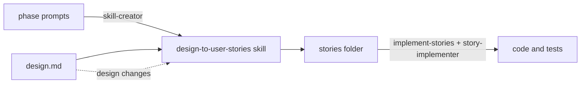

# design-to-user-stories

Turn a detailed design (`design.md`, containing the complete data model with its constraints) into small, secure, testable user stories that a weaker coding agent can implement. Keep the stories in sync as the design evolves, and implement them one story or one set of stories at a time.

This guide covers three things:

1. [Generating the skill](#2-generate-the-skill) from the three prompts, with skill-creator.
2. [Using the skill](#4-use-the-skill) to create and update the stories.
3. [Implementing the stories](#5-implement-the-stories), choosing a single story or a set.

The [Glossary](#glossary) at the end explains every acronym used here and in the prompts.



## Quick start

1. Generate the skill: run the three prompts, in order, with skill-creator ([§2](#2-generate-the-skill)).
2. Install it in `.claude/skills/` ([§3](#3-install-or-update-the-skill)).
3. Run `/design-to-user-stories docs/design.md`, approve the checkpoint, and the stories are written ([§4](#4-use-the-skill)).
4. Install the `implement-stories` skill and the `story-implementer` subagent ([Appendix A](#appendix-a--claudeskillsimplement-storiesskillmd) and [Appendix B](#appendix-b--claudeagentsstory-implementermd)).
5. Run `/implement-stories FND-000`, then `/implement-stories next:3`, or any other selection ([§5](#5-implement-the-stories)).
6. When the design changes, rerun step 3, then implement the new or changed stories.

## 1. Prerequisites

- **Claude Code** is recommended for everything. A claude.ai conversation with code execution is enough to generate the skill, but implementation needs a repository, so use Claude Code or another coding agent for that part.
- **Python 3 with PyYAML**, and **git**.
- **The prompt files:** `phase-1-init.md`, `phase-2-sync.md`, `phase-3-discovery.md`.
- **Eval inputs:**
  - one or two real, anonymized `design.md` files;
  - for phase 3, a small runnable repository with tests.
- **Your answers to the Project defaults block of phase 1:** default stack, ASVS level, output folder, data model format, git, anchor IDs. The target implementing agent is already set: Claude Sonnet 5.5 at medium effort ([§5.1](#51-set-up-once)).

> Tip for design authors: give each section a stable ID, e.g. `<!-- id: ORD-01 -->` under its heading. Renaming a heading then never breaks traceability.

## 2. Generate the skill

The skill is built once, in three phases.
- Each phase extends the same skill, under the same name, and produces a new `.skill` package that replaces the previous one.
- Only start a phase once the previous one passes its evals.

| Phase | Prompt | Attach | You get |
|---|---|---|---|
| 1. INIT, new projects | `phase-1-init.md` (fill in Project defaults first) | 1–2 design files; optional golden example | `design-to-user-stories.skill`, `fixture-b.zip` |
| 2. SYNC, design changes | `phase-2-sync.md` | phase-1 `.skill`, `fixture-b.zip`, design files | updated `.skill` |
| 3. DISCOVERY, existing projects | `phase-3-discovery.md` | phase-2 `.skill`, design files, a runnable repository (or run inside it) | final `.skill` |

For each phase:

1. Open a new session: Claude Code (inside the repository for phase 3), or a claude.ai conversation with code execution.
2. Paste the prompt and attach the files.
3. Answer skill-creator's questions. Review every eval output and give feedback until the evals pass.
4. Download what the phase produces.

Notes:

- In Claude Code, skill-creator runs the evals in parallel with subagents and compares them against a run without the skill. In claude.ai, it runs them one at a time and skips the benchmarks.
- Files don't carry over between claude.ai conversations. Keep the `.skill` and `fixture-b.zip` files, and attach them to the next phase.

## 3. Install or update the skill

**claude.ai:** click **Save skill** on the `.skill` file card (available if your organization allows skill creation).

**Claude Code:** a `.skill` file is a zip containing the skill folder.

```bash
rm -rf .claude/skills/design-to-user-stories
unzip design-to-user-stories.skill -d .claude/skills/
```

To install it for all your projects, use `~/.claude/skills/` instead.

**Optional:** add `disable-model-invocation: true` to the installed `SKILL.md` frontmatter, so the skill only runs when you call it.
- Don't add it before packaging: skill-creator's validator rejects that key.
- Leave it out if you plan headless syncs ([§4.6](#46-automation)), which rely on Claude invoking the skill.

Installing a new version never reformats existing stories.

## 4. Use the skill

### 4.1 Command

```text
/design-to-user-stories <design.md> [--out <folder>] [--plan] [--non-interactive] [--rebaseline]
```

In claude.ai, attach the design and ask, for example: "Generate the user stories from this design."

| Option | Effect |
|---|---|
| `--out <folder>` | Output folder. Default: Project defaults, or the project's docs folder. |
| `--plan` | Previews what would be created or changed; writes nothing. |
| `--non-interactive` | Never waits for you (CI). Decisions become proposals, listed in the summary. |
| `--rebaseline` | Full re-decomposition. Use only when you really mean it; it is recorded as an ADR. |

The mode is chosen automatically:

| Situation | Mode |
|---|---|
| No `STORY_MAP.md` in the output folder | INIT: first decomposition |
| `STORY_MAP.md` exists | SYNC: incremental update |
| Existing code in the project root | DISCOVERY runs first |

### 4.2 First run

1. Run the command.
2. In an existing project, review `PROJECT_PROFILE.md`. Every fact cites the file it comes from; correct wrong ones in its **Overrides** section.
3. At the checkpoint, review the modules, contracts, ASVS levels and open questions. Approve or correct them.
4. The skill writes the stories folder and prints a summary.
5. Commit the folder.

### 4.3 What you get

| Path | Purpose | Read by |
|---|---|---|
| `STORY_MAP.md` | Dashboard: modules, story counts by status, next implementable stories | you, orchestrators |
| `STATUS.md` | One line per story: `ID \| status \| reviewer \| note` | agents, orchestrators, you |
| `CONVENTIONS.md` | Stack, commands, security baseline, Definition of Done, agent rules | implementing agent (auto-loaded) |
| `README.md` | How an orchestrator hands a story to the agent | orchestrators |
| `GLOSSARY.md` | One English term per domain concept | skill, you |
| `OPEN_QUESTIONS.md` | Questions, then an Answers section | you |
| `PROJECT_PROFILE.md` | Existing projects: facts with evidence, plus Overrides | skill, you |
| `CHANGELOG.md` | One entry per run | you |
| `decisions/` | ADRs: module decisions and restructuring proposals | you |
| `modules/<module>/` | `MODULE.md`, `contracts.md`, `model.md`, one file per story | implementing agent (the story and its `read_first` files) |
| `_meta/` | Index, baseline, order, traceability | scripts, orchestrators |

Story statuses, in `STATUS.md`:

| Status | Meaning | Set by |
|---|---|---|
| `todo` | Ready once its dependencies are done | skill |
| `in_progress` | Being implemented, or waiting for review (note "ready for review") | agent |
| `blocked` | The agent stopped; the note says why | agent |
| `done` | Implemented, tests pass, reviewed if high-risk | agent, or the reviewer for high-risk stories |
| `obsolete` | Removed from the design; the ID is kept | skill |

### 4.4 Your touchpoints

| To… | Do this |
|---|---|
| Answer an open question | Edit the design (preferred), or the Answers section of `OPEN_QUESTIONS.md`, then rerun the skill |
| Approve a restructuring | Set the ADR's status to `accepted`, then rerun |
| Correct a deduction | Edit the Overrides section of `PROJECT_PROFILE.md`, then rerun |
| Approve fixing a known issue | Mark it `approved` in `PROJECT_PROFILE.md`, then rerun |
| Keep a manual addition in a story | Wrap it in `<!-- manual -->` … `<!-- /manual -->`; future syncs leave it alone |

### 4.5 When the design changes

Edit `design.md` and rerun the same command. Formatting-only edits and renamed headings are absorbed without touching any story. For other changes, the effect depends on each impacted story's status:

| Story status | What the sync does |
|---|---|
| `todo` | Edits the story in place and bumps its `rev` |
| `in_progress` or `blocked` | Leaves it untouched, adds a change story, and flags it |
| `done` | Leaves it untouched and adds a change story listing the tests to update |
| removed from the design | `todo` becomes `obsolete`; `done` gets a removal story |

A few more rules apply:
- Data-model changes on shipped code produce migration stories (expand, migrate, contract), which are always high-risk.
- Modules never change on their own: restructurings are proposed as ADRs.
- Commit after each run.

### 4.6 Automation

- **Drift check in CI:** run the skill's `scripts/diff_design.py --check` (see its `--help` for arguments). It fails when the design changed but the stories weren't synced.
- **Headless sync:** run `claude -p "Use the design-to-user-stories skill on docs/design.md with --non-interactive"`, then review the result as a pull request.

## 5. Implement the stories

Implementation is done by the target agent, Claude Sonnet 5.5 at medium effort, one story at a time, each in a fresh context. You choose what to implement: one story, a list, a range, a module, or the next N implementable stories.

A set runs in a single command, but each story still gets its own context. This way, the agent never juggles several stories, and a failure stops cleanly at one story.

### 5.1 Set up once

1. Install the orchestrator skill ([Appendix A](#appendix-a--claudeskillsimplement-storiesskillmd)) as `.claude/skills/implement-stories/SKILL.md`.
2. Install the implementer subagent ([Appendix B](#appendix-b--claudeagentsstory-implementermd)) as `.claude/agents/story-implementer.md`. It runs on Claude Sonnet 5.5 (`claude-sonnet-5-5`) at medium effort.
   - While a story runs, `/tasks` shows the subagent's model and effort (Claude Code v2.1.242 or later).
   - If the effort shown isn't medium, start your session with `claude --effort medium`.
3. Implement FND-000 first: `/implement-stories FND-000`. It sets up CI, the test runner and the security scans, and makes the agent load `CONVENTIONS.md` automatically.
4. Work on a feature branch. The orchestrator commits once per story.

### 5.2 Choose what to implement

```text
/implement-stories <selection> [--with-deps] [--include-blocked] [--keep-going] [--plan] [--stories <folder>]
```

| Selection | Meaning |
|---|---|
| `AUTH-003` | One story |
| `AUTH-003,AUTH-005,PAY-002` | A list (commas or spaces) |
| `AUTH-003..AUTH-007` | A range within one module |
| `module:auth` | Every active story of a module |
| `next:5` | The next 5 implementable stories |
| `all` | Every `todo` story |
| `kind:change`, `risk:low` | Filters that narrow any selection above |

| Option | Effect |
|---|---|
| `--with-deps` | Adds missing dependencies to the selection instead of stopping |
| `--include-blocked` | Includes blocked stories, once you have fixed the cause |
| `--keep-going` | After a blocked story, continues with the stories that don't depend on it |
| `--plan` | Prints the resolved order and the skipped stories; implements nothing |
| `--stories <folder>` | Stories folder, if it isn't found automatically |

Examples:

```text
/implement-stories AUTH-001..AUTH-004 --plan     # preview the order
/implement-stories AUTH-001..AUTH-004            # implement them
/implement-stories module:catalog --with-deps    # a whole module, dependencies included
/implement-stories next:3 risk:low               # three low-risk stories
/implement-stories kind:change                   # every pending change story
```

### 5.3 How a selection is resolved

1. The selection is expanded into story IDs. An unknown ID stops the run.
2. Done and obsolete stories are skipped. Blocked and in-progress stories are skipped unless you name them explicitly (or use `--include-blocked`).
3. Every dependency must be done or selected. Otherwise, the run stops and lists the missing stories, unless `--with-deps` adds them.
4. Stories always run in dependency order (from `_meta/order.md`), whatever order you typed.
5. Each story runs in a fresh subagent context, which receives only the story's path.
6. After each story:
   - done: it is committed as `<ID>: <title>`, and the run moves to the next story;
   - high-risk: it is committed and left "ready for review", and the stories that depend on it wait;
   - blocked: the run stops, or continues with independent stories under `--keep-going`.

### 5.4 Review high-risk stories

The agent never marks a `risk: high` story as done. These cover authentication, access control, cryptography, payment, file upload and data migration.

1. Review the diff yourself, or with a stronger model.
2. Set the story to `done` in `STATUS.md`, with your name in the reviewer column.

Its dependents then become implementable.

### 5.5 Handle a blocked story

1. Read its note in `STATUS.md`.
2. Fix the cause, depending on what it is:
   - a question: answer it in the design, then rerun `/design-to-user-stories` to sync;
   - an environment problem: fix the environment;
   - an error in the story: correct the story.
3. Set its status back to `todo` and run the selection again.

### 5.6 Without Claude Code, or unattended

**Other coding agents.** Configure the agent with Claude Sonnet 5.5 (`claude-sonnet-5-5`) at medium effort, if it lets you set an effort level. Give it one story per session, in the order printed by `--plan` (or listed in `STORY_MAP.md`), with this prompt:

> Implement exactly one user story: `<path>`.
> Follow the agent rules in CONVENTIONS.md: TDD; never modify, weaken or delete a test unless the story lists it under "Tests to update"; open only the files the story names; never add an unlisted dependency.
> Update your line in STATUS.md: set it to in_progress when you start. At the end, set it to done; or keep in_progress with the note "ready for review" if the story has risk: high; or set blocked with a one-line note if you are stuck.
> Work through to the end without stopping to ask for confirmation; stop early only when you are blocked.
> Never edit any other file in the stories folder. Finish with the test output.

**Unattended (headless Claude Code).** Get the ordered IDs with `--plan`, then run one fresh session per story:

```bash
#!/usr/bin/env bash
# Usage: ./implement.sh FND-000 AUTH-001 AUTH-002   (IDs in the order printed by --plan)
set -euo pipefail
STORIES=docs/stories
MODEL=${MODEL:-claude-sonnet-5-5}   # Claude Sonnet 5.5
EFFORT=${EFFORT:-medium}            # keep it constant: changing effort invalidates the prompt cache
PROMPT='Implement exactly one user story: %s. Follow the agent rules in CONVENTIONS.md: TDD; never modify, weaken or delete a test unless the story lists it under "Tests to update"; open only the files the story names; never add an unlisted dependency. Set your line in STATUS.md to in_progress when you start. At the end, set it to done, or keep in_progress with the note "ready for review" if the story has risk: high, or set blocked with a one-line note if you are stuck. Work through to the end without stopping to ask for confirmation; stop early only when you are blocked. Never edit any other file in the stories folder. Finish with the test output.'

for id in "$@"; do
  file=$(ls "$STORIES"/modules/*/"$id"-*.md)
  claude -p "$(printf "$PROMPT" "$file")" \
    --model "$MODEL" --effort "$EFFORT" --max-turns 60 \
    --allowedTools "Read,Edit,Write,Glob,Grep,Bash(npm test *),Bash(npm run lint *)"
  if grep -Eq "^\|? *$id *\| *done *\|" "$STORIES/STATUS.md"; then
    git add -A && git commit -m "$id"
  elif grep -Eq "^\|? *$id *\|.*ready for review" "$STORIES/STATUS.md"; then
    git add -A && git commit -m "$id (ready for review)"
    echo "Review $id before continuing."; exit 0
  else
    echo "Stopped at $id: see its note in STATUS.md."; exit 1
  fi
done
```

Adapt the allowed commands to your stack. Keep that allowlist narrow, and never skip permission checks.

**Parallel work.** Run stories in parallel only when they have no dependency between them and belong to different modules. Give each one its own git worktree, then merge `STATUS.md` afterwards.

**Optional hardening.** A Claude Code hook can block any write under the stories folder except `STATUS.md`. The implementer then physically cannot edit the specs: hooks are enforced, whereas instructions can be ignored.

## 6. Troubleshooting

| Symptom | Cause and fix |
|---|---|
| "SYNC is not available yet" | Phase 2 isn't installed. Install the phase-2 `.skill`. |
| The skill asks whether to proceed as a new project | It found code in the project root, and phase 3 isn't installed. Answer the question, or install the phase-3 `.skill`. |
| A leftover lock is reported | A previous run was interrupted. The skill resumes from the files on disk. |
| The CI drift check fails | The design changed without a sync. Run `/design-to-user-stories`. |
| `/implement-stories` refuses to run | Some Claude Code versions mishandle `disable-model-invocation`. Remove that line from the skill's frontmatter. |
| The agent stops before finishing, to ask for confirmation | At lower effort levels, Sonnet 5.5 sometimes checks in before a coding task is done. The implementer's instructions tell it to finish. If it persists, rerun that story with the headless script at high effort: `EFFORT=high ./implement.sh AUTH-003`. |
| The agent changed a test it shouldn't have | Reject the change. Tests may only change when the story lists them under "Tests to update". |
| Stories are too big for your agent | Lower the budgets in phase 1's Project defaults (target agent, story size) before generating. |

## Appendix A — `.claude/skills/implement-stories/SKILL.md`

```markdown
---
name: implement-stories
description: Implements one or more user stories generated by design-to-user-stories, in dependency order, one fresh subagent per story. Use when asked to implement stories by ID, list, range, module or next N.
disable-model-invocation: true
---
# Implement stories

The selection and options come from $ARGUMENTS.

## Selection (combine freely)
- `AUTH-003`, or a list: `AUTH-003,AUTH-005`
- `AUTH-003..AUTH-007`: a range within one module
- `module:auth`: every active story of a module
- `next:N`: the first N todo stories, in order, whose dependencies are done or earlier in the list
- `all`: every todo story
- `kind:<kind>` and `risk:<level>`: filters that narrow the selection
Options: `--with-deps`, `--include-blocked`, `--keep-going`, `--plan`, `--stories <folder>`.

## Resolve (read as little as possible)
1. Stories folder: `--stories`, else the folder that contains STORY_MAP.md.
2. Read STATUS.md and _meta/order.md. For candidate stories, read only the front matter (up to the second `---`), and only when a filter or a dependency check needs it.
3. Expand the selection. If an ID is unknown, stop and list it.
4. Skip, stating the reason:
   - done and obsolete stories;
   - blocked stories, unless named explicitly or `--include-blocked`;
   - in_progress stories, unless named explicitly.
5. Every depends_on must be done or selected. Otherwise, stop and list the missing stories, or add them with `--with-deps`.
6. Order: always the order in _meta/order.md, whatever the order typed.
7. With `--plan`, print the ordered list (ID, path, risk) and the skipped stories with reasons, then stop.

## Run, one story at a time
For each story, in order:
1. Delegate it to the story-implementer subagent, passing only the story path. Never pass other stories: each story gets a fresh context.
2. Wait until the subagent has finished (it may run in the background) before doing anything else.
3. Then read the story's line in STATUS.md:
   - done: commit with the message `ID: title`, then continue;
   - in_progress with the note "ready for review" (risk: high): commit, then skip the stories that depend on it;
   - blocked or anything else: stop. With `--keep-going`, continue only with stories that don't depend on it.
4. Never edit story files or CONVENTIONS.md yourself.

## Summary
List the stories implemented, awaiting review, blocked (with their notes) and skipped, and suggest the next command to run.
```

## Appendix B — `.claude/agents/story-implementer.md`

```markdown
---
name: story-implementer
description: Implements exactly one user story file from the stories folder, following CONVENTIONS.md. Use only when given the path of a story file.
tools: Read, Edit, Write, Bash, Glob, Grep
model: claude-sonnet-5-5
effort: medium
---
You implement exactly one user story: the file whose path you were given.
Work through to the end without stopping to ask for confirmation. The only reasons to stop early are the blocked cases in step 5.

1. Read CONVENTIONS.md if it isn't already loaded, then the story, then only the files the story lists in read_first and Implementation.
2. Set the story's line in STATUS.md to in_progress.
3. Follow the agent rules in CONVENTIONS.md:
   - TDD: write the tests, watch them fail, implement the minimum, go green, refactor;
   - never modify, weaken or delete a test unless the story lists it under "Tests to update";
   - never disable a security check or a lint rule;
   - never add a dependency that is not in the allowlist;
   - open only the files the story names.
4. Run the story's tests while iterating, then the full suite once at the end.
5. Update the story's line in STATUS.md:
   - done: all tests pass and the story's risk is low or medium;
   - in_progress, with the note "ready for review": all tests pass and the risk is high;
   - blocked, with a one-line note: after 3 failed attempts on the same error, or when anything is ambiguous (write the question as the note; never guess).
6. Never edit story files, CONVENTIONS.md, or anything else in the stories folder except your line in STATUS.md.
7. End with the test output as evidence and a two-line summary.
```

Why these settings:

- `claude-sonnet-5-5` is the full model ID, so it always pins Claude Sonnet 5.5. The `sonnet` alias, by contrast, can resolve to whichever Sonnet version your main session runs.
- `medium` is the level Anthropic recommends for well-specified agent tasks, which is what these stories are. Raise it to `high` only for a story that keeps getting blocked.
- Keep the effort constant from one run to the next: changing it invalidates the prompt cache.
- To target another agent, change `model` and `effort` here and in the headless script ([§5.6](#56-without-claude-code-or-unattended)).

## Glossary

Acronyms used in this guide and in the three prompts, with what each means in this workflow.

### Process and project management

| Acronym | Stands for | In this workflow |
|---|---|---|
| ADR | Architecture Decision Record | A short file recording one important decision: title, status, context, decision and consequences. The status moves from proposed to accepted, and later possibly to superseded. ADR-001 records how the design was split into modules. A restructuring is only proposed as a new ADR, and nothing changes until you accept it. |
| CI | Continuous Integration | The automated pipeline that builds and tests every change. FND-000 sets it up, and `diff_design.py --check` can run in it. |
| PR | Pull Request | A change submitted for review before it is merged. The rule is one story = one PR. |
| TDD | Test-Driven Development | Write a failing test first, then the minimum code to make it pass, then clean up. The implementing agent must work this way. |
| DoD | Definition of Done | The checklist a story must meet before it can be marked done: tests pass, scans are clean, high-risk stories are reviewed. It lives in `CONVENTIONS.md`. |
| INVEST | Independent, Negotiable, Valuable, Estimable, Small, Testable | Bill Wake's quality criteria for a good user story. |
| SPIDR | Spike, Paths, Interfaces, Data, Rules | Mike Cohn's five ways to split a story that is too big. The skill uses all of them except spikes: spikes are open-ended research, so unknowns go to `OPEN_QUESTIONS.md` instead. |
| CRUD | Create, Read, Update, Delete | The four basic data operations. The skill must not assume them when the design doesn't describe them. |
| DDD | Domain-Driven Design | Eric Evans' approach. Its "aggregates" and "bounded contexts" guide how entities are grouped into modules. |
| NFR | Non-Functional Requirement | A quality requirement (performance, security, accessibility…) rather than a feature. |

### Security and standards

| Acronym | Stands for | In this workflow |
|---|---|---|
| OWASP | Open Worldwide Application Security Project | The nonprofit foundation that publishes most security references used here: ASVS, Top 10, Cheat Sheets, WSTG. |
| ASVS | Application Security Verification Standard | OWASP's catalog of verifiable security requirements (version 5.0.0). Stories cite its requirement IDs, e.g. `v5.0.0-6.2.1`. |
| L1 / L2 / L3 | ASVS levels 1, 2, 3 | Increasing levels of assurance. L1 is a baseline for any application, L2 suits most business applications handling sensitive data, and L3 is for high-risk systems. |
| CWE | Common Weakness Enumeration | MITRE's catalog of software weakness types. The "CWE Top 25" lists the most dangerous ones. |
| STRIDE | Spoofing, Tampering, Repudiation, Information disclosure, Denial of service, Elevation of privilege | Microsoft's six threat categories, used for each module's lightweight threat model. The threats become abuse cases. |
| SAST | Static Application Security Testing | Tools that scan source code for vulnerabilities without running it. FND-000 installs one. |
| NIST | National Institute of Standards and Technology | The US standards agency. |
| SSDF, SP 800-218 | Secure Software Development Framework, Special Publication 800-218 | NIST's set of secure development practices; SP 800-218 is the document's number. |
| WSTG | Web Security Testing Guide | OWASP's catalog of security test cases. |
| MASVS | Mobile Application Security Verification Standard | OWASP's equivalent of ASVS for mobile apps. |
| API | Application Programming Interface | Appears in the "OWASP API Security Top 10", used when your system exposes an API. |
| LLM | Large Language Model | Appears in the "OWASP Top 10 for LLM Applications", relevant if your system includes AI features. |
| PII | Personally Identifiable Information | Any data that identifies a person. It is never logged and never used in test data. |
| GDPR | General Data Protection Regulation | The EU data protection law (RGPD in French). |
| WCAG | Web Content Accessibility Guidelines | The accessibility standard from the W3C (World Wide Web Consortium), version 2.2. It applies when there is a user interface (UI). |
| ISO/IEC 25010 | International Organization for Standardization / International Electrotechnical Commission, standard 25010 | A software quality model, used as a checklist of non-functional requirements. |
| ISTQB | International Software Testing Qualifications Board | The source of boundary-value analysis: each constraint is tested just inside and just outside its limits. |

### Data and file formats

| Acronym | Stands for | In this workflow |
|---|---|---|
| ORM | Object-Relational Mapping | A library that maps code objects to database tables, such as Prisma or Hibernate. DISCOVERY detects which one a project uses. |
| FK | Foreign Key | A column that points to a row in another table. Adding one to existing data requires a migration. |
| YAML | YAML Ain't Markup Language | A human-readable data format. It is used for the stories' front matter, and as the input the rendering script turns into story files. |
| JSON | JavaScript Object Notation | The format of the machine-readable files in `_meta/`, such as `index.json` and `backlog.json`. |
| CSV | Comma-Separated Values | The format of the official ASVS export the skill queries. |
| UTF-8 | Unicode Transformation Format, 8-bit | The standard text encoding; the design file must use it. |

### IDs specific to this workflow

| ID | Meaning | In this workflow |
|---|---|---|
| FND-000 | Foundation, story 000 | The "walking skeleton", implemented first: project layout, CI, test runner, security scans. |
| AC-n | Acceptance criterion n | A numbered expected behavior of a story, written in Gherkin (Given / When / Then). |
| AB-n | Abuse case n | A numbered attack scenario the code must resist, such as a user reading another user's data. |
